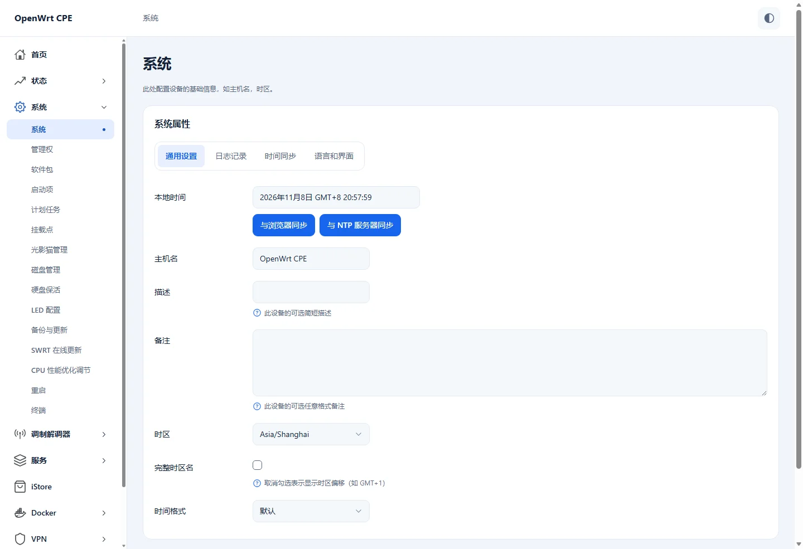

# Apollo for LuCI

**English** · [简体中文](README.zh-CN.md)

Apollo is a responsive LuCI theme designed for 5G routers, CPEs, and standard OpenWrt routers. It brings a consistent look to menus, tables, configuration forms, and dialogs. The desktop sidebar becomes a drawer on phones. Light, dark, and system modes are available. The header can display battery level on supported devices.

Use [wlmbstart](https://github.com/SlAlot/luci-app-wlmbstart) with Apollo for a 5G dashboard with signal, carrier, traffic, and device status. Apollo also runs independently.

## Preview



[Mobile preview](docs/images/mobile.webp)

## Compatibility

| OpenWrt | Release package |
| --- | --- |
| 23.05 | IPK |
| 24.10 | IPK |
| 25.12 | APK |

The theme is architecture-independent. The optional battery indicator uses data exposed by a compatible wlmb-server installation. Use a recent browser.

## Install

Download the package for your OpenWrt series from [Releases](https://github.com/SlAlot/luci-theme-apollo/releases). Transfer it to the router and run the command that matches its package manager.

```sh
opkg install ./luci-theme-apollo*.ipk
# OpenWrt 25.12
apk add --allow-untrusted ./luci-theme-apollo*.apk
```

In LuCI, open **System → System → Language and Style** and select **Apollo**.

## Build into your firmware

Add the following feed to the active `feeds.conf` or `feeds.conf.default` in your OpenWrt source tree.

```text
src-git apollo https://github.com/SlAlot/luci-theme-apollo.git;main
```

```sh
./scripts/feeds update -a
./scripts/feeds install -a
make menuconfig
```

Select `<*>` under **LuCI → Themes → luci-theme-apollo**. Save and build your firmware.

If the default feeds are already set up, update and install only the added feed.

```sh
./scripts/feeds update apollo
./scripts/feeds install -a -p apollo
```

## License

See [LICENSE](LICENSE) for SlAlot's non-commercial terms and [LICENSES](LICENSES) for third-party notices.
