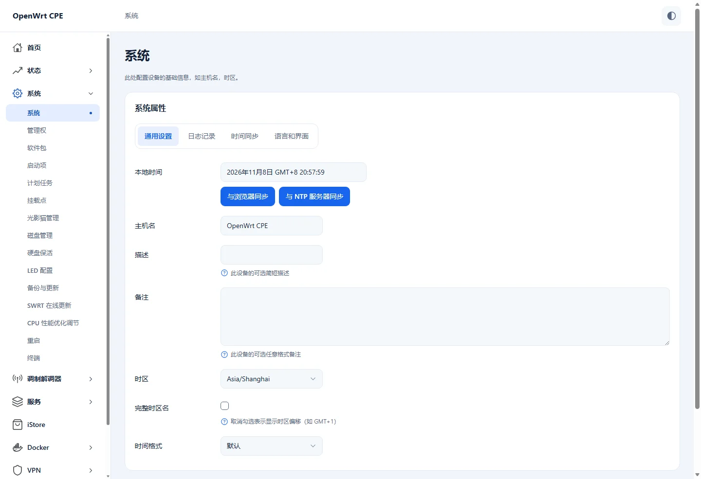

# Apollo LuCI 主题

[English](README.md) · **简体中文**

Apollo 是面向 5G 路由器、CPE 和普通 OpenWrt 路由器的响应式 LuCI 主题。菜单、表格、表单和弹窗采用统一的视觉样式。手机使用抽屉导航，支持浅色、深色与跟随系统外观。有兼容电池数据的设备可在顶栏显示电量。

推荐搭配 [wlmbstart](https://github.com/SlAlot/luci-app-wlmbstart)，在首页集中查看 5G 信号、载波、流量和设备状态。Apollo 也可独立使用。

## 界面预览



[手机端预览](docs/images/mobile.webp)

## 兼容性

| OpenWrt | 安装包 |
| --- | --- |
| 23.05 | IPK |
| 24.10 | IPK |
| 25.12 | APK |

主题与 CPU 架构无关。可选的电量显示需要兼容的 wlmb-server 提供电池数据。 请使用近期版本的浏览器。

## 安装

从 [Releases](https://github.com/SlAlot/luci-theme-apollo/releases) 下载对应 OpenWrt 版本的安装包，上传到路由器后执行对应命令。

```sh
opkg install ./luci-theme-apollo*.ipk
# OpenWrt 25.12
apk add --allow-untrusted ./luci-theme-apollo*.apk
```

安装后在 LuCI 的 **系统 → 系统 → 语言和界面** 选择 **Apollo**。

## 快速编译进固件

在 OpenWrt 源码目录生效的 `feeds.conf` 或 `feeds.conf.default` 中加入：

```text
src-git apollo https://github.com/SlAlot/luci-theme-apollo.git;main
```

```sh
./scripts/feeds update -a
./scripts/feeds install -a
make menuconfig
```

在 **LuCI → Themes → luci-theme-apollo** 选择 `<*>`。 保存配置后编译固件。

已经准备好默认 Feed 时，也可以只更新和安装本次新增的 Feed。

```sh
./scripts/feeds update apollo
./scripts/feeds install -a -p apollo
```

## 许可

原创部分采用 SlAlot 的非商业许可，见 [LICENSE](LICENSE)。第三方组件的声明见 [LICENSES](LICENSES)。
